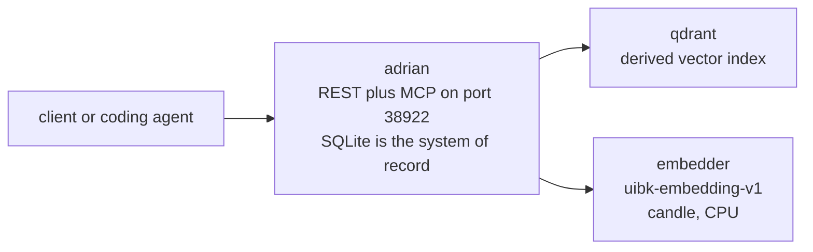

# Adrian

An opinionated database for architectural decision records. v0.1.0.

Adrian stores decisions rather than documents. A decision is parsed into a typed projection,
chunked along the lines the MADR template already draws, embedded with a late-interaction
retrieval model, and indexed so that a coding agent can ask "what constrains this file" and
get an answer with citations that point at the exact bytes of the source.

## The shape of it



Only `adrian` publishes a port. Qdrant and the embedder are implementation details of the
database, reachable only from inside the compose network.

## Guarantees worth knowing

- **SQLite is the system of record.** Qdrant holds vectors and identifiers only. If the two
  disagree, Qdrant is wrong and can be rebuilt from SQLite without data loss. `adrian check`
  reports the drift and exits non-zero rather than repairing it quietly.
- **Every citation is byte exact.** Sections and items carry `byte_start` and `byte_end` into
  the submitted source, so a reference can be verified by slicing the original file.
- **An agent cannot accept its own decision.** `adr_submit` always creates the record as
  `proposed`. Accepting it is a separate `adr_transition`, a distinct and auditable act.
- **Text lives in one place.** Qdrant never stores chunk text, so a citation cannot point at
  a copy that has drifted from the record.
- **Import is lossless until you edit.** A record imported from Markdown and never modified
  exports as its original bytes, not as a re-rendering.

## Quickstart

Prerequisites are Docker with compose v2, `make`, `curl` and `jq`.

```bash
cp .env.example docker/.env      # compose reads .env beside the compose file
make weights                     # one time, about 720 MB, checksum verified
docker compose -f docker/docker-compose.yml up -d --build
```

`make weights` fails loudly on a corrupt or partial download. Re-fetch with
`scripts/fetch_weights.sh --force`.

Then:

```bash
# create a project
curl -s localhost:38922/v1/projects \
  -H 'content-type: application/json' \
  -d '{"slug":"demo","name":"Demo"}' | jq

# ingest an ADR from the bundled corpus
curl -s localhost:38922/v1/adrs \
  -H 'content-type: application/json' \
  -d "$(jq -Rn --rawfile s fixtures/madr/real/madr__0013-use-yaml-front-matter-for-meta-data.md \
        '{project:"demo", external_ref:"docs/adr/0013-front-matter.md", source:$s, actor:"human:me"}')" | jq

# search
curl -s localhost:38922/v1/search \
  -H 'content-type: application/json' \
  -d '{"query":"should metadata live in yaml front matter","project":"demo"}' | jq
```

Embedding runs in the background. `GET /v1/adrs/{id}/chunks` reports whether a chunk has a
vector yet.

## The `adrian` binary

```bash
adrian serve                                       # the daemon that compose runs
adrian mcp-stdio --url http://127.0.0.1:38922      # stdin proxy for agents that spawn a process
adrian project add --slug demo --name Demo         # create a project
adrian import --project demo --dir docs/adr        # bootstrap a corpus from Markdown
adrian export --project demo --format madr --out decisions.md
adrian project rm --slug demo --force              # delete a project and everything in it
adrian migrate                                     # apply pending migrations, then exit
adrian check                                       # compare SQLite against the vector index
```

`export` writes one file, or stdout when `--out` is absent. `check` reports only, because a
reconcile that silently fixes things hides the bug that caused the drift.

`import` is the bootstrap path for a corpus that already exists. Each document keeps the
status its own front matter declares, which is why it is an operator command rather than a
tool an agent can call. A second run over unchanged files reports every file as `unchanged`
and enqueues no work. An interrupted import can therefore be run again as it is.
`--dry-run` parses the whole corpus and reports what would land, including duplicate
display numbers, without writing anything.

Removing a project needs `--force`. The vector index is cleared before the database. Stop
the daemon first so the embed worker cannot race the deletion.

## Connecting a coding agent

Two forms, both backed by the same eight tools.

Streamable HTTP, on the port the daemon already exposes:

```json
{
  "mcpServers": {
    "adrian": { "type": "http", "url": "http://127.0.0.1:38922/mcp" }
  }
}
```

stdio, for agents that insist on spawning a process:

```json
{
  "mcpServers": {
    "adrian": {
      "command": "adrian",
      "args": ["mcp-stdio", "--url", "http://127.0.0.1:38922"]
    }
  }
}
```

The tools are `project_list`, `adr_search`, `adr_get`, `adr_list`, `adr_submit`, `adr_similar`,
`adr_transition` and `adr_context_for`. See [docs/API.md](docs/API.md).

## Environment

| Variable | Default | Meaning |
| --- | --- | --- |
| `ADRIAN_BIND` | `0.0.0.0:38922` | Address the HTTP server binds to. |
| `ADRIAN_PORT` | `38922` | Host port published by compose. Read by compose only. |
| `ADRIAN_DB_PATH` | `/data/adrian.db` | SQLite file. |
| `ADRIAN_QDRANT_URL` | `http://127.0.0.1:6333` | Qdrant base URL. Compose overrides it with the container address. |
| `ADRIAN_EMBEDDER_URL` | `http://127.0.0.1:8081` | Embedding engine base URL. Compose overrides it with the container address. |
| `ADRIAN_COLLECTION` | `adr_chunks__uibk_v1` | Qdrant collection for chunk vectors. |
| `ADRIAN_API_TOKEN` | *(empty)* | Static bearer token for `/v1`. Empty disables auth. |
| `ADRIAN_MCP_TOKEN` | *(empty)* | Static bearer token for `/mcp`. Falls back to `ADRIAN_API_TOKEN`. |
| `ADRIAN_WORKER` | `1` | Run the background embed worker in this process. |
| `ADRIAN_MAX_BODY_BYTES` | `4194304` | Maximum accepted request body. |
| `ADRIAN_LOG` | `info` | `tracing` filter directive. |
| `ADRIAN_EMBED_MODEL` | `uibk-embedding-v1` | Model the engine must be serving. |
| `ADRIAN_EMBED_VERSION` | `1` | Model version the engine must be serving. |

The daemon refuses to start when the engine reports a different model or version, because
comparing vectors from two models produces plausible nonsense rather than an error.

Compose forwards a subset of these. `ADRIAN_PORT`, `ADRIAN_COLLECTION`, `ADRIAN_API_TOKEN`,
`ADRIAN_MCP_TOKEN`, `ADRIAN_WORKER` and `ADRIAN_LOG` are interpolated from `docker/.env`. The
rest have to go into a compose override file, including `ADRIAN_MAX_BODY_BYTES`,
`ADRIAN_EMBED_MODEL` and `ADRIAN_EMBED_VERSION`.

The embedding engine container reads its own three:

| Variable | Default | Meaning |
| --- | --- | --- |
| `EMBEDDER_BIND` | `0.0.0.0:8081` | Address the engine binds to. Never published. |
| `ADRIAN_WEIGHTS_DIR` | `/models` in the image | Directory holding the model files and `SHA256SUMS`. |
| `RUST_LOG` | `info` | `tracing` filter for the engine. |

## What v0.1.0 does not do

Stated plainly, because a database that quietly implies more than it delivers is worse than
one that does less.

- **No clustering into decision points.** The cross-project question "30 of 40 projects chose
  tokio, here is why" needs a problem-space clustering tier. Not in this version.
- **No bitemporal valid-time queries.** Status is stored as an event log, so the history is
  there, but there is no "which decisions were in force on 2024-03-01" query yet.
- **No scope decay tracking.** Scope is an assertion by the client. Adrian cannot see a
  repository, so it cannot notice that a path it was told about no longer exists.
- **No multi-tenancy.** One workspace, one user. A single optional bearer token stands in for
  authentication.
- **No verified actor identity.** `actor` on every write is an unverified string, so anything
  can claim to be `human:you`.
- **No GPU.** CPU only, with a `cuda` feature flag present in the embedder crate but off.
- **No repository scanning, ever.** Documents arrive over the API. Adrian has no filesystem
  view of your project and never will.

## Layout

```
crates/adrian-core/   domain types, MADR parser, chunker, SQLite store, Qdrant client
crates/adrian-api/    axum router, REST handlers, MCP server
crates/adrian-bin/    the `adrian` binary
embedder/             separate workspace: the candle inference engine
migrations/           SQL schema
fixtures/madr/        real MADR corpus used by parser and round-trip tests
fixtures/golden/      reference embeddings generated from the model's own Python
scripts/              weight fetch, smoke test, golden oracle
docs/                 API, architecture and MADR support notes
docker/               compose file and both Dockerfiles
```

The embedder is a separate cargo workspace so that `cargo test` on the daemon does not have
to compile candle.

## Development

Needs Rust 1.85 or newer. `make golden` also needs `uv`.

```bash
make check      # fmt, clippy, both test suites
make test
make up / down / logs
make weights    # fetch model weights
make golden     # regenerate reference embeddings (needs uv + torch)
make smoke      # full end-to-end against the compose stack
```

`make smoke` is the only check that exercises three containers, a real model, a real vector
index, a real ingest and a real search. It takes minutes and it is the one test a stub cannot
fake. Pass `--keep` to leave the stack running afterwards.

## Documentation

- [docs/API.md](docs/API.md) covers REST, MCP and the error contract.
- [docs/ARCHITECTURE.md](docs/ARCHITECTURE.md) explains why the system is shaped this way.
- [docs/ADR-SUPPORT.md](docs/ADR-SUPPORT.md) covers what parses, what does not, and why.

## Licence

Apache-2.0.
